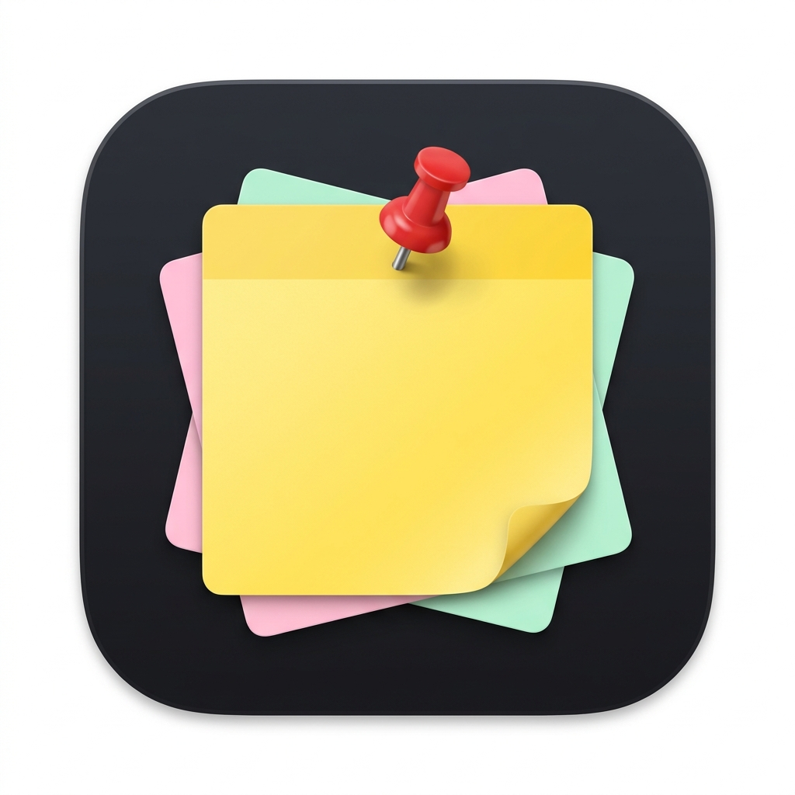

<div align="center">
  
  <h1>Post-it Studio</h1>
  <p><strong>Tauri v2 + React + Tailwind CSS v4 + SQLite ile geliştirilmiş, macOS estetiğinde 2.5D fiziksel masaüstü Post-it, Ajan Panosu ve iOS StandBy Saat uygulaması.</strong></p>
</div>

---

## ✨ Öne Çıkan Özellikler

### 1. 🧲 Manyetik Desteden Koparma & Gerçek Kâğıt Dokusu
- **Post-it Yığını (`StickyStack`):** Masaüstünün köşesinde `-3°`, `1.5°` ve `0°` doğal açılarla üst üste duran, tamamen opak, yuvarlatılmış (`rounded-3xl`) ve organik mat kâğıt dokulu (`paper-texture`) deste.
- **Manyetik Koparma Fiziği:** En üstteki yaprağı sürüklerken önce desteye tutunan doğrusal olmayan bir manyetik direnç hissedilir; eşik (`115px`) aşıldığında bağ kopar ve kâğıt yay (`spring`) fiziğiyle imlece sıçrayarak bırakıldığı `(x, y)` koordinatına yapışır.
- **Yığını Taşıma & Gizleme:** Sol üstteki 6 noktalı tutamaçtan (`GripHorizontal`) tüm yığın ekranın istenen yerine taşınabilir; sağ üstteki `-` butonuyla yalnızca yığın gizlenirken ekrana yapıştırılmış notlar açık kalır.
- **6 Özel Post-it Renk Paleti:** *Klasik Sarı, Pastel Pembe, Nane Yeşili, Gökyüzü Mavisi, Lavanta Moru* ve *Şeftali Turuncusu*.
- **Boyutlandırma:** Varsayılan en küçük boyut (`210×210 px`) ile maksimum (`340×340 px`) aralığında sağ alt köşeden serbestçe boyutlandırılabilir.

### 2. 📌 2.5D Gerçekçi Raptiye ile Pencereye / Masaüstüne Sabitleme
- Her Post-it'in üst ortasında kutusuz, **2.5D kırmızı plastik başlıklı ve gri çelik iğneli bir raptiye (`RealisticThumbtack`)** bulunur.
- **Pencere Algılama (Win32 Z-Order Tracking):** Raptiyeye tıklandığında iğne kâğıda saplanır ve tam altındaki pencereyi (**Masaüstü**, **Chrome**, **Edge**, **VS Code**, **Dosya Gezgini** vb.) otomatik algılar.
- Sabitlendiği uygulama küçültüldüğünde (`minimize`) veya arkaya düştüğünde Post-it de onunla birlikte gizlenir ve tıklama geçişini (`click-through`) serbest bırakır; pencere tekrar öne geldiğinde Post-it otomatik olarak geri açılır.

### 3. 🧶 Kırmızı Ajan İpi Bağlantıları & Bağlı Grup Hareketi
- Bir kâğıdın üstündeki kırmızı raptiyeye basılı tutup başka bir kâğıda sürüklediğinizde iki raptiye arasında **2.5D dokulu kırmızı dedektif/ajan ipi (`AgentStringsLayer`)** bağlanır.
- **Yerçekimi Sarkması & Gitar Teli Titreşimi:** İp bağlandığında veya bağlı kâğıtlardan biri taşındığında ip gerçek bir tel gibi sönümlü harmonik hareketle titreşir ve mesafeye göre yerçekimiyle sarkar.
- **Zincirleme Grup Davranışı:** İple birbirine bağlı kâğıtlar tek bir küme (`Cluster`) gibi davranır:
  - Biri çöp kutusuna yaklaştırıldığında bağlı tüm kâğıtlar bulundukları yerde eşzamanlı olarak buruşur ve bırakıldığında beraber silinir.
  - Biri saklama sepetine atıldığında tüm bağlı grup beraber sepete girer ve sepetten çıkarıldığında ipleriyle beraber ekrana geri döner.
  - İpin orta noktasında beliren **Makas (`Scissors`)** ikonuna tıklanarak bağ kesilebilir.

### 4. 🗑️ 2.5D Çöp Kovası & Kâğıt Buruşma Animasyonu
- Herhangi bir kâğıt sürüklenmeye başlandığında sağ alt köşeden 45° çapraz açıyla **2.5D fırçalanmış çelik çöp kovası (`TrashDock`)** kayarak gelir.
- Kâğıt çöp kovasına yaklaştığında kovanın **3 boyutlu metal kapağı 36° yukarı açılır**; kâğıt ise 12 köşeli çokgen (`clip-path`) ve 3D katlanma/kırışma yüzeyleriyle (`CrumpledPaperCreases`) **buruşmuş bir kâğıt topuna** dönüşerek kovaya düşer.

### 5. 🧺 %10 Sağ Kenar Çubuğu & 2.5D Hasır Saklama Sepeti
- Ekranın sağ kenarında `%10` opaklıkta ince bir açıcı çubuk durur. Basılı tutup sola doğru çekildiğinde manyetik dirençle esner ve **2.5D Hasır / Ceviz Saklama Sepeti (`BasketDock`)** ekrana gelir (sağa doğru itildiğinde tekrar kenara gizlenir).
- Sepete bırakılan notlar silinmez; sepetin içinden gerçek renkleriyle dışarı taşan mini Post-it yaprakları olarak görünür. Üzerine tıklandığında ayar penceresine gerek kalmadan doğrudan ekrandaki yerine geri fırlar.

### 6. ⏱️ iOS StandBy Masa Saati & `@25d` / `@19.20` Çoklu Sayaç Halkaları
- Masaüstünde yaşayan **2.5D iOS StandBy Mode** tasarımında masa saati eklentisi (`DeskClockWidget`):
  - Üzerine tıklanarak **StandBy Analog** (radyal dikdörtgen çizgiler, turuncu saniye ibresi, `GÜN TARİH`) ve **StandBy Bubble Dijital** (3D büyük pastel rakamlar) modları arasında geçiş yapılır.
- **Not İçinden Akıllı Zamanlayıcı:** Herhangi bir Post-it içine `@25d `, `@15dk `, `@30s ` (süre) veya `@19.20 `, `@19:20 ` (hedef saat) yazıp boşluk bırakıldığında:
  - İfade not içinde vektörel saat ikonlu şık bir kapsül rozete dönüşür.
  - StandBy Masa Saati'nin dış çerçevesinde **o Post-it'in kendi renginde parlayan bir ilerleme halkası** oluşur. Aynı anda birden fazla notta sayaç kurulursa saatin etrafında **iç içe geçmiş (concentric) çok renkli halkalar** döner.
  - Süre dolduğunda hem ilgili notlar hem de masa saati öne çıkarak titrer ve sesli uyarı verir.

### 7. ✍️ Canlı Markdown, Etkileşimli Todo, Serbest Çizim & `Ctrl+V` Görsel
- **Canlı Markdown (`MarkdownEditor`):** Yazarken kapanış karakteri konulduğu anda `**kalın**`, `*italik*`, `~~üstü çizili~~`, `==vurgu==`, `` `kod` ``, `# Başlık` ve `- Liste` formatlarına anında dönüşür.
- **Etkileşimli Yapılacaklar (Todo):** Satır başında `[] ` veya `[ ] ` yazıldığında tıklanabilir kutucuk oluşur; işaretlendiğinde metnin üstü çizilir (`Enter` ile alt satırda otomatik yeni kutucuk açılır).
- **Vektörel Serbest Çizim (`DoodleCanvas`):** Alt bardaki **Kalem** ikonuyla kâğıt üzerine *Mürekkep Kalem*, *Kırmızı Kalem* veya *Fosforlu Vurgulayıcı* ile çizim yapılabilir.
- **Panodan Görsel Yapıştırma (`Ctrl+V`):** Kopyalanmış ekran görüntüleri veya resimler `Ctrl+V` ile doğrudan Polaroid çerçeveli görsel olarak nota yapıştırılabilir.

### 8. 🗄️ Gömülü SQLite (`postit.db`) & Şeffaf Click-Through Katmanı
- **Click-Through (`setIgnoreCursorEvents`):** Fare yalnızca Post-it'lerin, yığının, saatin veya aktif sepet/çöp kutusunun üzerindeyken tıklamaları yakalar; masaüstü boş alanlarında tüm tıklamalar arkadaki uygulamalara geçer.
- **System Tray (Sistem Tepsisi):** Görev çubuğunda (`skipTaskbar: true`) yer kaplamaz; sağ alttaki sistem tepsisinden yığın, masa saati ve sepet yönetilebilir.
- **SQLite Veritabanı (`rusqlite` bundled + WAL modu):** Tüm notlar, koordinatlar, boyutlar, çizimler, ip bağlantıları ve zamanlayıcılar `%APPDATA%\postit\postit.db` (`C:\Users\<Kullanıcı>\AppData\Roaming\postit\postit.db`) içinde yerel SQLite veritabanında saklanır.

---

## 🛠️ Kurulum ve Geliştirme

### Gereksinimler
- **Node.js** (v18+)
- **Rust & Cargo** (Tauri v2 masaüstü derlemesi için)

### Bağımlılıkları Yükleme ve Geliştirme Modu
```bash
npm install
npm run tauri dev
```

### Production Kurulum Paketi (`.exe` / `.msi` Installer) Üretme
```bash
npm run tauri build
```
Derleme tamamlandığında kurulum dosyaları şu dizinlerde oluşturulur:
- **NSIS Setup (`.exe`):** `src-tauri/target/release/bundle/nsis/postit_0.1.0_x64-setup.exe`
- **MSI Installer (`.msi`):** `src-tauri/target/release/bundle/msi/postit_0.1.0_x64_en-US.msi`
- **Portable (`.exe`):** `src-tauri/target/release/postit.exe`

---

## 📂 Proje Dizin Yapısı

```text
postit/
├── app-icon.png                     # 1:1 2.5D macOS Post-it & Raptiye uygulama logosu
├── src/
│   ├── App.jsx                      # Ana masaüstü katmanı, click-through ve pencere görünürlük yönetimi
│   ├── App.css                      # Tailwind CSS v4 ve organik kağıt dokusu (.paper-texture)
│   ├── components/
│   │   ├── StickyStack.jsx          # Manyetik koparmalı ve taşınabilir Post-it yığını
│   │   ├── PinnedNote.jsx           # 2.5D kırmızı raptiyeli, boyutlandırılabilir ve kırışabilen Post-it kartı
│   │   ├── AgentStringsLayer.jsx    # Raptiyeler arası 2.5D kırmızı ajan ipi, yerçekimi ve titreşim fiziği
│   │   ├── DeskClockWidget.jsx      # 2.5D iOS StandBy (Analog & Bubble Dijital) masa saati ve çoklu sayaç halkaları
│   │   ├── MarkdownEditor.jsx       # Canlı Markdown, etkileşimli Todo, @25d sayaç rozeti ve Ctrl+V görsel editörü
│   │   ├── DoodleCanvas.jsx         # Vektörel serbest el çizim ve fosforlu kalem katmanı
│   │   ├── BasketDock.jsx           # %10 sağ kenar çubuğuyla açılan 2.5D hasır saklama sepeti
│   │   └── TrashDock.jsx            # 45° çapraz açılan, hareketli kapaklı 2.5D metalik çöp kovası
│   └── hooks/
│       └── useNotesStore.js         # SQLite + localStorage senkronizasyonu ve bağlı grup (cluster) yönetimi
└── src-tauri/
    ├── Cargo.toml                   # Tauri v2, tray-icon ve gömülü rusqlite bağımlılıkları
    ├── tauri.conf.json              # Şeffaf, çerçevesiz, her zaman üstte masaüstü pencere yapılandırması
    └── src/
        └── lib.rs                   # Win32 Z-Order pencere algılama, SQLite WAL motoru, System Tray ve hit-test
```
